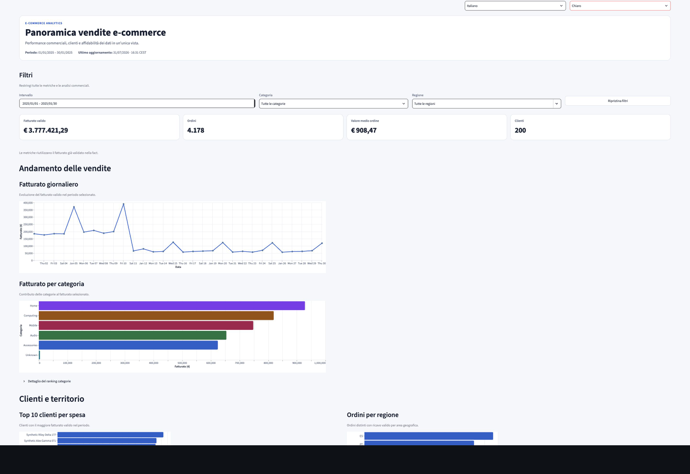
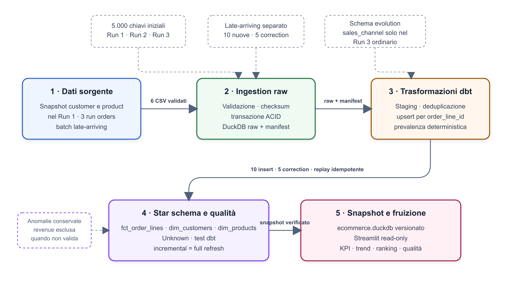
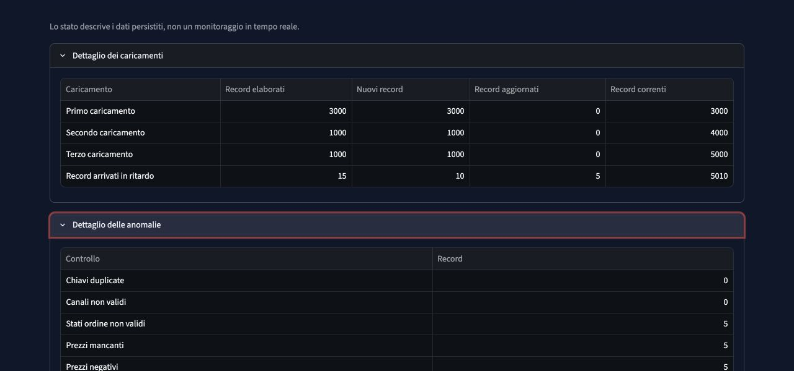

# E-commerce dbt DuckDB Pipeline

## TL;DR

Pipeline e-commerce riproducibile che integra snapshot anagrafici e ordini incrementali.
Gestisce replay idempotenti, late-arriving records e correzioni tramite upsert deterministico.
dbt produce e verifica uno star schema con anomalie osservabili e metriche economiche coerenti.
I risultati sono consultabili in una dashboard Streamlit read-only.

[](https://github.com/samueldvi/ecommerce-dbt-duckdb-pipeline/actions/workflows/ci.yml)

Progetto tecnico di Data Engineering per dati e-commerce che trasforma ordini incrementali, correzioni e dati arrivati in ritardo in uno star schema verificato e in una dashboard business interattiva.

[Apri la demo online](https://ecommerce-dbt-duckdb-pipeline-97sughgocnjpxtwwm6mm7h.streamlit.app/) · [Dashboard](#dashboard-streamlit) · [Architettura](#architettura) · [Esecuzione locale](#esecuzione-locale) · [Documentazione](#documentazione)

> **Synthetic demo data / dati sintetici**
>
> Tutti i dati sono sintetici. Lo snapshot
> `data/warehouse/ecommerce.duckdb` è mantenuto intenzionalmente nel repository
> esclusivamente per la demo; Streamlit lo apre sempre in modalità read-only.



## Problema business

Un flusso e-commerce non riceve sempre ordini perfetti e definitivi: nuovi
record arrivano in finestre successive, alcune righe vengono corrette dopo il
primo caricamento e lo schema può evolvere nel tempo. Senza regole condivise,
fatturato, valore dei clienti, categorie e territori rischiano di produrre
risultati incoerenti. Il progetto costruisce una base analitica deterministica
che conserva le anomalie, aggiorna soltanto le versioni prevalenti e rende
tracciabile ogni caricamento. La dashboard traduce il modello dimensionale in
KPI e analisi consultabili, mantenendo separata la presentazione dalla logica
economica già validata in dbt.

## Soluzione

- genera sei CSV sintetici deterministici con ordini a una o più righe;
- acquisisce dati e manifest nella stessa transazione DuckDB, con checksum e
  replay idempotente;
- elabora tre finestre ordinarie e un batch late-arriving separato;
- risolve deduplicazione, correction e schema evolution con dbt;
- conserva record anomali, applica membri `Unknown` e calcola il fatturato
  valido nella fact;
- espone mart e controlli di qualità tramite uno snapshot DuckDB versionato,
  consultato dalla dashboard Streamlit in sola lettura.

## Risultati principali

I valori sono stati riconfermati direttamente sui mart DuckDB, senza usare la
dashboard come oracolo.

### Risultati business

| Metrica | Risultato | Significato |
|---|---:|---|
| Fatturato valido | € 3.777.421,29 | Somma della misura `revenue` per righe economicamente valide |
| Ordini distinti | 4.178 | Ordini presenti nel periodo analizzato |
| Valore medio ordine | € 908,47 | Fatturato valido diviso per gli ordini con ricavo |
| Clienti | 200 | Clienti business correnti, escluso il membro tecnico `Unknown` |

### Risultati tecnici e di qualità

| Metrica | Risultato | Significato |
|---|---:|---|
| Righe correnti della fact | 5.010 | Una riga prevalente per `order_line_id` |
| Chiavi iniziali | 5.000 | Tre finestre ordinarie su 30 giorni |
| Late-arriving insert | 10 | Nuove chiavi con data commerciale storica |
| Correction applicate | 5 | Chiavi del Run 1 aggiornate da una versione successiva |
| Duplicati finali | 0 | Unicità del grain dopo l'upsert |
| Replay | Idempotente | Rieseguire gli stessi input non cambia lo stato finale |
| Full refresh | Corrispondente | Fact e dimensioni coincidono con il risultato incrementale |
| Anomalie | Conservate | Righe non valide osservabili ma escluse dal fatturato |

## Architettura



1. **Dati sorgente:** Python produce snapshot completi di clienti e prodotti e
   ordini incrementali in CSV. Gli importi restano decimali e il seed rende
   l'output byte-identico.
2. **Ingestion raw:** i CSV vengono validati e caricati nello schema `raw` di
   DuckDB. Dati e manifest condividono il confine transazionale; checksum e
   provenienza rendono il replay verificabile.
3. **Trasformazioni dbt:** le view di staging tipizzano e normalizzano; il
   livello intermediate seleziona deterministicamente la versione corrente.
   L'upsert gestisce 10 insert tardivi, 5 correction e l'introduzione di
   `sales_channel` nel solo Run 3 ordinario.
4. **Modello analitico:** `fct_order_lines` conserva il grain della riga
   d'ordine e si collega a `dim_customers`, `dim_products` e `dim_date`.
   Test generici e singolari verificano chiavi, relazioni e regole economiche.
5. **Persistenza e fruizione:** lo snapshot finale DuckDB conserva raw,
   manifest e mart `analytics`. La dashboard lo apre esclusivamente in modalità
   read-only ed esegue query aggregate senza ricalcolare il fatturato in Python.

Il diagramma è mantenuto anche come
[sorgente Mermaid](docs/architecture/workflow.mmd) e
[sorgente SVG](docs/architecture/workflow.svg). I dettagli su upsert e
trasferimento cloud sono disponibili in
[Gestione incrementale](docs/GESTIONE_INCREMENTALE.md) e nel
[piano Databricks](docs/TRASFERIMENTO_DATABRICKS.md).

## Incrementalità, late-arriving e data quality

Le anagrafiche clienti e prodotti sono snapshot completi del Run 1. Soltanto
gli ordini sono suddivisi in tre finestre: 3.000 righe dal 1° al 10 gennaio,
1.000 dall'11 al 20 e 1.000 dal 21 al 30. La ripartizione è una scelta
deterministica dell'implementazione; il requisito normativo è il totale di
5.000 chiavi iniziali.

`order_line_id` è la chiave stabile dell'upsert. Il batch tardivo separato
contiene 10 nuove chiavi con data commerciale storica e 5 versioni più recenti
di righe del Run 1. Il confronto usa `updated_at` e, a parità, il payload
canonico: replay e ordine di arrivo non producono duplicati. Un test confronta
lo stato incrementale finale con un vero `dbt build --full-refresh`.

`sales_channel` compare soltanto nel Run 3 ordinario; per Run 1, Run 2 e batch
tardivo viene allineato a `NULL`. Ordini annullati, stati fuori dominio, prezzi
nulli o negativi e quantità non positive restano nella fact ma non generano
`revenue`. Le chiavi cliente o prodotto orfane sono collegate ai membri
surrogate `Unknown`, senza perdita di fatti.

## Modello dati

| Modello | Grain | Responsabilità |
|---|---|---|
| `analytics.fct_order_lines` | Una riga corrente per `order_line_id` | Misure, validità economica, revenue e chiavi dimensionali |
| `analytics.dim_customers` | Una riga per `customer_id` | Stato corrente SCD Type 1 e membro `Unknown` |
| `analytics.dim_products` | Una riga per `product_id` | Prodotto, categoria e membro `Unknown` |
| `analytics.dim_date` | Una riga per giorno | Calendario stabile e attributi settimanali/mensili |

## Funzionalità principali

- generazione deterministica e pubblicazione transazionale dei CSV;
- ingestion ACID con manifest, checksum e isolamento verificato;
- caricamenti incrementali, upsert idempotente e tie-break canonico;
- late-arriving facts, correction e schema evolution per nome colonna;
- anomalie conservate ma escluse dalle metriche quando previsto;
- chiavi dimensionali orfane risolte sui membri tecnici `Unknown`;
- quattro analisi: fatturato per categoria/mese, top 10 clienti, ordini per
  regione/settimana e ranking mensile delle categorie;
- dashboard bilingue, temi chiaro/scuro e filtri globali.

## Stack tecnologico

| Tecnologia | Ruolo |
|---|---|
| Python 3.12 | Generazione sintetica, ingestion e test |
| DuckDB | Raw layer, manifest, persistenza locale e motore analitico |
| dbt Core + dbt-duckdb | Trasformazioni, incrementalità, test e modello dimensionale |
| SQL | Regole di qualità, star schema e analisi |
| Streamlit | Dashboard business read-only |
| GitHub Actions | Suite automatizzata su pull request e `main` |

## Dashboard Streamlit

La demo mostra fatturato, ordini, valore medio, clienti, trend giornaliero,
contributo delle categorie, clienti principali, territori, caricamenti e
qualità dei dati. Lingua e tema sono selezionabili dall'interfaccia; periodo,
categoria e regione filtrano tutte le analisi business.

<details>
<summary>Caricamenti incrementali e anomalie conservate</summary>



</details>

La demo usa lo snapshot sintetico versionato
`data/warehouse/ecommerce.duckdb`. Non esegue generazione, ingestion o
trasformazioni all'avvio: verifica la presenza delle risorse richieste e apre
il file con `read_only=True`. Se lo snapshot manca, è illeggibile o incompleto,
mostra un errore controllato con i comandi di ricostruzione. La dashboard non
richiede `profiles.yml` né segreti.

Il percorso predefinito è `data/warehouse/ecommerce.duckdb` e lo schema è
`analytics`. Sono disponibili gli override `ECOMMERCE_DB_PATH` e
`ECOMMERCE_DBT_SCHEMA`.

## Esecuzione locale

### Sistemi operativi supportati

Il generatore, l'ingestion, dbt e la dashboard supportano Python 3.12 su Linux,
macOS e Windows. La CI esegue l'intera suite Python sia su Ubuntu sia su Windows;
macOS viene verificato localmente. Il lock del generatore usa `filelock` e non
dipende da API disponibili soltanto sui sistemi Unix.

### 1. Ambiente

```bash
python3.12 -m venv .venv
source .venv/bin/activate
python -m pip install -r requirements.txt
cp profiles.yml.example profiles.yml
dbt debug --profiles-dir .
```

`profiles.yml` resta locale e ignorato da Git; `profiles.yml.example` è il
template riproducibile.

Su Windows l'attivazione equivalente in PowerShell è:

```powershell
py -3.12 -m venv .venv
.venv\Scripts\Activate.ps1
python -m pip install -r requirements.txt
Copy-Item profiles.yml.example profiles.yml
dbt debug --profiles-dir .
```

### 2. Pipeline completa

```bash
python scripts/generate_synthetic_data.py
python scripts/ingest_raw_data.py load-all
dbt build --profiles-dir .
```

I sei output sono:

```text
data/raw/run_1/customers.csv
data/raw/run_1/products.csv
data/raw/run_1/orders.csv
data/raw/run_2/orders.csv
data/raw/run_3/orders.csv
data/raw/run_3/late_arriving/orders.csv
```

L'ultimo file è il batch late-arriving separato dal Run 3 ordinario. Per
riprodurre manualmente i caricamenti incrementali:

```bash
python scripts/ingest_raw_data.py load-batch run_1
dbt build --profiles-dir .
python scripts/ingest_raw_data.py load-batch run_2
dbt build --profiles-dir .
python scripts/ingest_raw_data.py load-batch run_3
dbt build --profiles-dir .
python scripts/ingest_raw_data.py load-batch run_3_late_arriving
dbt build --profiles-dir .
```

### 3. Dashboard

```bash
streamlit run streamlit_app.py
```

Lo snapshot incluso consente di avviare direttamente la demo. L'interfaccia
locale è disponibile normalmente su `http://localhost:8501`.

### 4. Query analitiche

```bash
dbt show --profiles-dir . --limit 100 --inline "$(cat analyses/revenue_by_category_month.sql)"
dbt show --profiles-dir . --limit 100 --inline "$(cat analyses/top_10_customers_by_spend.sql)"
dbt show --profiles-dir . --limit 100 --inline "$(cat analyses/completed_orders_by_region_week.sql)"
dbt show --profiles-dir . --limit 100 --inline "$(cat analyses/monthly_category_revenue_ranking.sql)"
```

## Test e data quality

```bash
python -m pip install -r requirements.txt -r requirements-dev.txt
python -m pip check
PYTHONPYCACHEPREFIX=/tmp/python-cache python -m compileall scripts dashboard tests
python -m ruff check scripts dashboard tests streamlit_app.py
python -m ruff format --check scripts dashboard tests streamlit_app.py
python -m pytest -q
python -m pip_audit -r requirements.txt -r requirements-dev.txt
gitleaks git --redact --no-banner --log-opts="--all" .
dbt build --profiles-dir .
dbt test --profiles-dir .
```

La suite copre determinismo byte-per-byte, importi `Decimal`, transazioni ACID,
rollback, isolamento, persistenza, replay idempotente, schema evolution,
correction, membri `Unknown`, revenue, query analitiche e comportamento
read-only della dashboard. Gitleaks è uno strumento esterno da installare
separatamente per la scansione locale della cronologia. La CI esegue test,
lint, formatting check, validazioni dbt e scansioni di sicurezza a ogni pull
request verso `main` e a ogni push su `main`.

## Struttura del progetto

```text
analyses/                 query analitiche dbt
dashboard/                configurazione, accesso read-only, query e presentazione
data/                     raw generati ignorati e snapshot analitico versionato
docs/                     contratti, architettura e piano Databricks
models/staging/           normalizzazione delle sorgenti raw
models/intermediate/      deduplicazione e selezione corrente
models/marts/             fact e dimensioni analitiche
scripts/                  generazione sintetica e ingestion
tests/                    test Python e test dbt singolari
streamlit_app.py          entry point della dashboard
```

## Documentazione

- [Requisiti tecnici](docs/requirements.md)
- [Chiarimenti normativi](docs/clarifications.md)
- [Contratti dati](docs/data_contracts.md)
- [Metriche attese machine-readable](docs/expected_run_metrics.yml)
- [Gestione incrementale](docs/GESTIONE_INCREMENTALE.md)
- [Trasferimento concettuale verso Databricks](docs/TRASFERIMENTO_DATABRICKS.md)
- [Workflow architetturale](docs/architecture/workflow.svg)
- [Linee guida per contribuire](CONTRIBUTING.md)
- [Politica di sicurezza](SECURITY.md)
- [Licenza MIT](LICENSE)

## Limiti

- DuckDB è adatto a esecuzione locale, test e demo analitiche, ma non sostituisce
  un warehouse distribuito o un motore multiwriter.
- Il progetto non include orchestrazione schedulata, object storage o un
  deployment Databricks reale; il documento di trasferimento descrive il
  percorso concettuale.
- Lo snapshot DuckDB è una fotografia statica, sintetica e riproducibile della
  pipeline: la dashboard non lo aggiorna e un nuovo stato richiede una
  ricostruzione esplicita.
## Autore

Progetto tecnico di Data Engineering per dati e-commerce mantenuto da
[@samueldvi](https://github.com/samueldvi).
